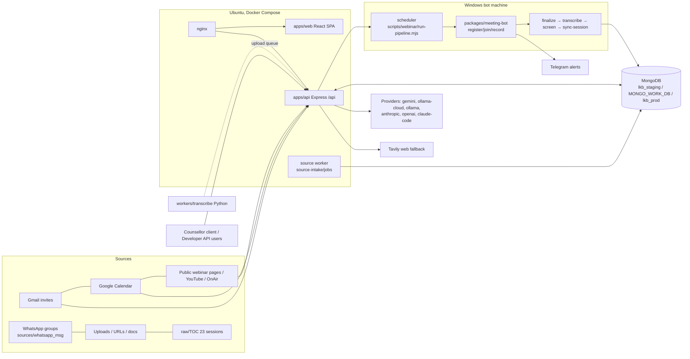

# HLD — Living Knowledge Base (as of 2026-10-28)

> **Audience: AI code editors (Claude Code, Codex).** Read this, then `docs/LLD.md` for file:line detail.
> Ground truth for rules is `ARCHITECTURE.md`; decisions are `docs/DECISIONS.md`; task status is
> `.goal/goal.json` / `TASKS.md`; live-app reality is `references/portals/lkb-live.knowledge.md`.
> This file cites those sources — it does not replace them. If they disagree, they win; fix this file.

## 1. Goal

**North star (`.goal/goal.json`):** a knowledge base that is the brain of an AI virtual counsellor which
matches, then beats, top human counsellors in head-to-head evaluation (public "championship").
**Phase 1 exit:** `POST /ask` over the TOC sessions returns speaker+timestamp-cited internal answers,
with web fallback for off-corpus questions.

| Release | Acceptance (goal.json `release_order`) | Groups |
|---|---|---|
| **R1 Operational** | Real invite/discovered webinar → register if needed → join → usable capture → actual alert; recover after interruption; Windows first, Ubuntu independently verified | G1 discovery, G2 capture, G9 ops |
| **R2 Usable KB** | Old TOC + WhatsApp + new webinar knowledge validated and searchable with speaker/timestamp citations; extraction/retrieval/answer gates pass | G3 identity, G4 enrichment, G5 retrieval, G6 UX, G8 eval |
| **R3 Counsellor product** | Accounts, platform, counsellor client, championship — complete independent acceptance (D-173/D-174). Own-model training NOT in scope (T-015 blocked) | G6–G9 (G10 deferred) |

Roadmap: 95 tasks — 55 done, 39 in_progress, 1 blocked (2026-10-28).

## 2. System context

## 3. End-to-end pipeline — stage table

Status legend: **B** = built in code · **L✓** = working on live (2026-10-26 audit) · **L✗** = broken/unconfigured on live · **→** remaining task IDs.

| # | Stage | Owner (entry) | In → Out | Status |
|---|---|---|---|---|
| 1 | **Discover** | `apps/api/src/gws/gws-gmail.ts`, `gws-calendar.ts`, `public-webinars.ts`; `scripts/watch/run-watch.mjs`; `scripts/watched-sources/supervisor.ts` | Gmail/Calendar/Drive/URLs → `meeting_candidates`, `watch_state`, `watch_reports` | B · L✗ (`gws` not on server, watchers never polled; `/calendar/upcoming` 503) · → T-036, T-053; Codex branch adds hosted bridge |
| 2 | **Register / Join** | `packages/meeting-bot/src/calendar/registration-workflow.ts`, `packages/meeting-bot/src/joiners/browser-joiner.ts`, `packages/meeting-bot/src/calendar/auto-join.ts`; join rules `apps/api/src/join-rules/` | candidates + join rules → registered/joined meeting | B (one browser joiner, U4.2) · L✗ (send-now 503, join-rules 503, rules not enforced) · → T-037, T-039, T-052 |
| 3 | **Capture** | `packages/meeting-bot/src/capture/record-commands.ts` `runRecord`; backends `packages/meeting-bot/src/capture/tab-browser.ts`, `packages/meeting-bot/src/capture/obs/` | meeting URL → `raw/webinars/<slot>/*.webm` + `data/toc-migrated/<id>/source.json` | B (reconnect, watchdogs, detached controller T-029–T-033, T-047) · runs on bot machine, not server · → T-034, T-035, T-051 |
| 4 | **Transcribe** | `scripts/transcribe-long-session.mjs` + `packages/ai/src/stt/*`; queued uploads: `workers/transcribe/src/worker.py` | audio → `turns.json` (+ `validation.json`) | B (Gemini diarization; 23 TOC sessions done T-003) · → T-044, T-048, T-050 |
| 5 | **Screen / vision** (optional) | `scripts/webinar/process-video.mjs` | video → `screen-evidence.json`, `notes.json` | Partial · → T-041 |
| 6 | **Extract** | `@lkb/index`: `summarizeSession`, `extractClaims`, `extractDecisions`, `buildTopicIndex`, `resolveSpeakers` | turns → `session_pages`, `claims` (always `needs-review`), `topics`, `orgs`, `speakers`, `decisions` | B · L partial: 1768 claims, **0 speakers, all claims needs-review** · → U2.2–U2.5, T-007, T-040, T-042 |
| 7 | **Index** | `scripts/webinar/sync-session.mjs` → `apps/api/src/indexing/session.ts` `indexSession` | turns/claims → `tree_index`, `chunks` (lexical; **vectorless**, D-173), `graph_edges`, `index-proof.json` | B · L✓ for 20/22 sessions (2 index FAILED) · → T-008, T-043 |
| 8 | **Ask** | `packages/ask/src/ask-v2.ts` `askV2` via `POST /ask` (`apps/api/src/routes/ask/ask.ts`) | question → tree/lexical retrieval → evaluator → internal answer, or Tavily web fallback when `insufficient_coverage` → cited answer, `answer_runs` | B · L partial (right source, verdict "ambiguous", ~2 min; **no web fallback: TAVILY_API_KEY unset**) · → T-022, U0.10, T-056 |
| 9 | **Surface** | `apps/web` pages, `apps/api` routes, Telegram (`packages/meeting-bot/src/capture/notify/`), knowledge outputs | KB → UI, API, alerts, FAQs/reports, counsellor | B · L mixed (see §6) · → T-013, T-028, T-054–T-058, T-057 |

**Two parallel ingest paths besides webinars:** `POST /ingest` (sync URL ingest via Jina → index; **L✓ tested**) and
`POST /ingest/source` (queued, `LKB_SOURCE_INTAKE=1`, worker `apps/api/src/source-intake/jobs/entry.ts`).

## 4. Key design decisions (current, not historical)

| Topic | Current choice | Source |
|---|---|---|
| Stack | TS pnpm monorepo; Express API; React SPA; Python only in `workers/transcribe` and `packages/meeting-bot/py` | D-003 |
| Store | MongoDB, every row `tenantId`, every index leads with `tenantId`; schema-first (`schema/*.schema.json` → generated TS) | H5, ARCHITECTURE §5 |
| Retrieval | **Vectorless** in active ingestion (tree index + lexical chunks + graph). Vector retriever code exists (`packages/index/src/vector`) but no embedding step runs on ingest | D-173 (supersedes H1's vector half / D-021) |
| Ask | CRAG: tree/lexical retrieval → evaluator → internal answer; Tavily web fallback when `insufficient_coverage` (`packages/ask/src/ask-graph.ts` `evaluateNode`), sources cited separately | H2 |
| Provenance | No fact without `evidence[]` → turn/session; claims land as `needs-review` | H3 |
| Providers | Per-job-kind chain in `config/ai-routing.yaml`: transcribe→gemini; summarize/claims/decisions/ask→ollama-cloud; speakers→local ollama | H10 |
| Auth | API key only (`lkb_`+48 hex, sha256 stored); tenant derived from key, never from the client; exact-match scopes | `apps/api/src/auth.ts` |
| Capture | Provided-first; tab capture default, OBS fallback; runs on a Windows bot machine | H8, D-195 (Codex branch: server-owned capture) |

## 5. Deployment topology

- **Server (Ubuntu, Docker Compose, from `master`)** — nginx (https, same-origin `/api`) + api + web.
  Runbook: `docs/GO-LIVE-UBUNTU.md`. URL & audit: `references/portals/lkb-live.knowledge.md`.
- **Bot machine (Windows)** — scheduler `pnpm webinar:run --watch --run`, meeting bot, Chrome profile,
  FFmpeg. Not in the compose stack.
- **MongoDB host** — shared with other Vidysea DBs; IP-allowlisted, **auth still off** (enable `lkb_app`, §6a).
- **Databases** — `lkb_staging` (local pipeline writes here), `MONGO_WORK_DB` (isolated work DBs),
  `lkb_prod` (live; populated 2026-10-26 by copying staging). **New pipeline output does not reach live
  until a writer targets `lkb_prod`.**
- **Env groups the server needs** (full list in LLD §6): core Mongo · hosting (4× `LKB_HOSTING_*`, all or none) ·
  `GEMINI_API_KEY` · `TAVILY_API_KEY` · WhatsApp Mongo · gws/calendar · bot/capture. Plan (Umesh, 2026-10-28):
  validate locally from `.env`, then roll the same config to live.

## 6. Live status snapshot (2026-10-26 audit of 48 pages)

| Bucket | Pages / features |
|---|---|
| **Working** | sessions, session detail, search, ingest URL, claims, knowledge/*, explorer, brain, jobs, status, transcript-review |
| **Partial** | Ask (no web fallback, slow), dashboard, operations, calendar, setup, ops-health, meeting-bot (one 503 panel each) |
| **Broken** | AI counsellor (0 sources), knowledge outputs (422: all claims needs-review), send-now (503), settings/keys, accounts, automation, calibration/extraction/label review, activity-health, join-rules (503 hosting), whatsapp (500), connectors (404 router not mounted), knowledge/profiles (blank) |

Root causes: (1) hosting env unset → every 503; (2) `GEMINI_API_KEY`/`TAVILY_API_KEY` unset;
(3) WhatsApp Mongo unset; (4) all claims `needs-review` → outputs/counsellor refuse; (5) 0 speakers;
(6) bot/watchers not configured on server; (7) code gaps: `/connector-workflow` not mounted, `/knowledge/profiles` empty.

## 7. Work in flight outside this branch

`codex/calendar-bot-completion` (+4 commits on `0c2edb14`, 132 files, D-192..D-198, **not merged**):
hosted Calendar/Gmail bridge (Windows worker publishes owner-bound snapshots to the API), meeting-only
Gmail discovery with exclusion feedback, join-rule enforcement modes, timezone-aware dates, DB guards
(`lkb_prod` protected in `config/migrate-mongo-config.cjs`). Self-declared open: runtime privacy refusal,
live capture slots, restart/recovery, Ubuntu capture, 7-day scheduler observation, whole-branch review.

## 8. Remaining work — recommended order

1. **Docs** (this file + `docs/LLD.md`; refresh `ARCHITECTURE.md` from D-008 → current).
2. **Make live fully work** — config only: hosting env + tenant row, Gemini/Tavily keys, WhatsApp URL,
   Mongo auth, re-index the 2 failed sessions.
3. **Claims review policy** — 1768 `needs-review` claims block outputs and the counsellor.
4. **R1 end-to-end** — review/merge Codex branch, configure bot + gws, prove one real webinar →
   capture → transcript → index → visible on live.
5. **R2 quality** — speakers (U2.4/T-042), extraction gold (U2.2), search UX (U3.2), evaluator calibration (T-022).
6. **R3** — accounts (T-028), counsellor client (T-013), championship (T-014), platform (T-060/T-061).
