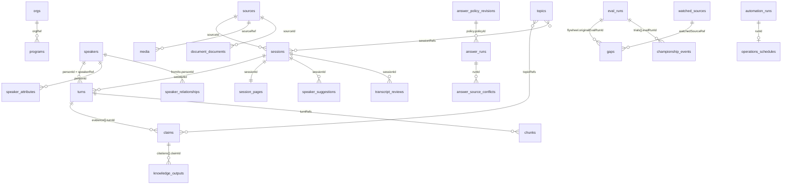
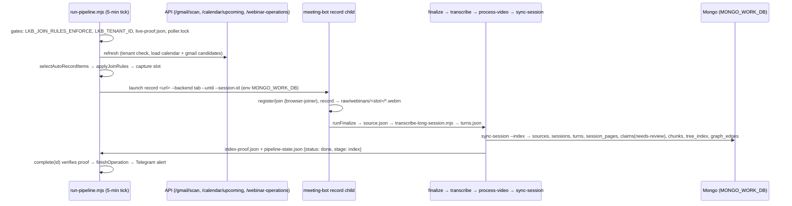

# LLD — Living Knowledge Base (as of 2026-10-28, branch `docs/devops-golive-2026-10-26` @ `0c2edb14`)

> **Audience: AI code editors.** Exact paths, entry functions, collections, env vars. Read `docs/HLD.md`
> first. Rules (tenancy, schema-first, dependency direction, LOC budgets) live in `ARCHITECTURE.md` §5
> and `structure.config.json` — obey them; this file does not restate them.
> Line numbers drift; treat `file:line` as a pointer, then grep the function name.

## 1. Packages (`packages/*`, all `@lkb/*`, `main: ./src/index.ts`, tests `node --test --import tsx`)

| Package | Purpose | Main public exports | Depends on |
|---|---|---|---|
| `core` | Generated types + pure domain logic + pipeline graph | `generated/<coll>.ts` (45 collections, **never hand-edit**; `pnpm gen:types`), `domain/{pipeline-workflow,purge-policy,lean-video,sender-authentication,slide-turn-alignment,speaker-tile-*,webinar-types}`, `alerts/alert-sink` | `@langchain/langgraph`, `zod` |
| `db` | Tenant-scoped Mongo accessors | `scopedCollection(db,name)(tenantId)`, `withTenant`, `assertValidTenantId` (`lib/tenantScope`), `collections/{sources,sessions,turns,claims,session-pages,gaps,graph-edges,watch-*,speaker-*,usage-events,…}`, `jobs` | core |
| `ai` | Provider seam + router + STT + tracing | `provider`, `router`, `routing-config`; `providers/{gemini,openai,anthropic,ollama,ollama-cloud,claude-code}`; `stt/{transcribe,whisper,gemini,gemini-file-upload,chunk-audio}`; `trace-langfuse/sink` | core |
| `ingest` | Source adapters, intake, gaps, watchers, join policy, retention | `tenantSourceId` (`source.ts:30`), `registry`, `intake`, `gap-tracking`; `sources/{recording,document,url,whatsapp,gdrive,youtube,onair,hosted-recording,…}`; `watched/{schedule,check,run}`; `createJoinPolicyDeps` | ai, core |
| `index` | Tree index, chunks, retrieval, extraction, graph, speakers | `buildTree`, `treeSearch`, `regenerate`, `buildChunks`, `lexicalSearchTurns`, `createVectorRetriever`, `summarizeSession`, `extractClaims`, `extractDecisions`, `buildTopicIndex`, `resolveSpeakers`, `personIdFor`, `buildKnowledgeGraph`, `verifyQuote(s)` | core, ai |
| `ask` | CRAG routing, evaluation, answer synthesis | `askV2` (`ask-v2.ts`), `ask` (`router.ts`), `selectNodes`, `evaluate` (+`UPPER_THRESHOLD`/`LOWER_THRESHOLD`), `refine`, `answer`, `heuristicScorer`, `sourceCatalog` | core, ai |
| `meeting-bot` | Discovery-to-capture for meetings | `joiners/{browser,vexa,system-audio}-joiner`, `calendar/{calendar-client,auto-join}`, `capture`, `live-monitor`, `capture/notify/*`; CLI `src/cli.ts` (`pnpm webinar:record`) | core, ingest |

Gotchas: `packages/db/src/collections/{orgs,topics,speakers,decisions}.ts` exist but are **not exported** from
the index. `core` pipeline-graph/runner/run-state modules are reached by deep import.

## 2. Data model (`schema/*.schema.json` = source of truth, 46 files = 45 collections + `features_event`; indexes in `schema/index.json`)

IDs are plain strings — **no `$ref`, no FK constraints**; relationships below are by field convention.
Source `_id` = `encodeURIComponent(tenantId):contentHash` (`packages/ingest/src/source.ts:30`).
`personId` = `personIdFor(displayName)` (`packages/index/src/pipeline/speakers.ts:75`).



**Evidence shapes (H3 provenance):**

| Where | Shape |
|---|---|
| `claims.evidence[]` (minItems 1) | `{turnId, sessionId, quote?}`; status `verified \| needs-review \| conflicting` |
| `decisions.evidence[]`, `speakers.evidence[]` | `{turnId, sessionId}` |
| `session_pages.evidence[]` | `{turnId, sessionId, quote}` all required |
| `knowledge_outputs.citations[]` | `{id, claimId, turnId, sessionId, speakerRef, start, end, unit, quote, href, …}` |
| `*.indexArtifact` (claims, pages, tree nodes) | `{version:1, generation:uuid4, sessionId, sourceId, turnDigest:sha256}` |

Standalone (no outgoing refs): `tenants`, `api_keys` (`keyHash` unique), `consent_policies`, `trusted_senders`,
`usage_events`, `watch_heartbeat`, `watch_reports`, `jobs` (provider-call audit, **not** a work queue), `orgs`.
`features_event` is the line schema of `docs/FEATURES.jsonl`, not a collection.

**Migrations:** `migrations/*.cjs` (migrate-mongo, config `config/migrate-mongo-config.cjs` with
`resolveMigrateTarget` prod guard). Baseline `20260903100000-baseline.cjs` applies `schema/index.json`.
Several later migrations are marked *source-only / not run by the maker* (knowledge-workflows,
speaker-relationships, speaker-attributes, registration-link-approvals, speaker-suggestions,
transcript-reviews) — the Approver applies them. Shape/index change = new migration, never ad-hoc.

## 3. API (`apps/api`)

**Boot:** `src/index.ts` loads root `.env` → `bootstrap.ts` `startFromEnv` → `requireDatabaseName`
(`db-name.ts`, `MONGODB_DB` required, no default) → `connect` → `buildProductionDeps`
(`composition/production.ts`) → `startServer` (`PORT`, default 3300).

**Middleware order (`src/server.ts` `createServer`):** requestLogger → json(1mb) → CORS → *public:*
`/compete` page, HTML pages (`routes/pages.ts`), `GET /health` → `requireAuth` → rate limit → usage →
`mountIntegratedWorkflows` (`composition/integrations/routes.ts`; absent dep ⇒ `requireScope` + 503
`workflow_unavailable`) → fixed routers → error handler (500 `internal_error`).

**Auth (`src/auth.ts`):** `Authorization: Bearer lkb_<48hex>` → `sha256Hex` → `api_keys.findOne({keyHash})`
(`store.ts:~50`) → `{tenantId, scopes, keyId}`. Missing/bad/revoked ⇒ 401. `requireScope(s)` exact match ⇒ 403.
Tenant comes **only** from the key. Scopes: `sessions ingest ask sources jobs compete gmail whatsapp join-rules
send-now search keys hosting citations calendar gaps graph automation:{read,write,operate}
answer-policy:{read,write} registration:approve webhooks operations`.

**Hosting gate:** `hosting/config.ts` `createConfiguredHostingDeps` needs all four of `LKB_HOSTING_STATE_DIR`,
`LKB_HOSTING_ENCRYPTION_KEY` (64 hex), `LKB_HOSTING_BOOTSTRAP_ADMINS` (JSON `{tenant:[keyIds]}`),
`LKB_HOSTING_WEBHOOK_ORIGINS` (JSON https array). Missing ⇒ `/keys`, `/hosting/*`, `/counsellor-accounts`
503. **Partial** set — or `LKB_COUNSELLOR_STATE_DIR` set without valid hosting — swaps `keyStore` to `failedAuthentication` ⇒ **every** authenticated request 503 (`composition/integrations/hosting.ts`).

**Routes (handler files under `apps/api/src/`):**

| Area | Method + path | Scope | File | Collections |
|---|---|---|---|---|
| health | GET /health | — | `routes/health.ts` | counts |
| ask | POST /ask | ask | `routes/ask/ask.ts` | tree_index, turns, claims → answer_runs |
| answers | /answer-history, /answer-reviews, /answer-evidence-conflicts, /answer-policies/*, /answer-policy/simulate | ask / answer-policy:* | `answer-policy/*` | answer_runs, answer_source_conflicts, answer_policy_* |
| sessions | GET /sessions, /sessions/:id, /sessions/:id/media, /webinar-operations | sessions | `routes/brain.ts` | sessions, turns, claims, session_pages |
| sources/gaps | GET /sources, /gaps | sources / gaps | `routes/brain.ts` | sources, gaps |
| search | GET /search (?q=); /search/semantic* **dormant in production** (`production.ts` sets `semanticSearch: undefined`, D-173) | search | `routes/search.ts`, `semantic-search/route.ts` | tree_index, turns, chunks |
| graph | GET /graph | graph | `routes/graph.ts` | graph_edges |
| citations/claims | GET /citations/:claimId, POST /citations/native/resolve, GET /claims | citations | `routes/citations.ts`, `native-evidence/router.ts`, `claims/router.ts` | claims, turns, sessions |
| ingest | POST /ingest (sync URL) ; POST /ingest/source + GET jobs (`LKB_SOURCE_INTAKE=1`) | ingest | `routes/ingest.ts`, `routes/ingest-source.ts` | sources, sessions, turns (+index) |
| knowledge | /knowledge/{documents,collections,topics,resources}, /knowledge-outputs/* | sessions / ingest / ask | `knowledge/*`, `knowledge-outputs/router.ts` | document_documents, knowledge_*, topics |
| speakers | /sessions/:id/speaker-suggestions, /speaker-profiles/*, /speaker-attributes, /speaker-relations | sessions | `speaker-*/router.ts` | speaker_* |
| transcript | /sessions/:id/transcript-review[/history,/refresh] | sessions | `transcript-review/router.ts` | transcript_review* |
| calendar/bot | GET /calendar/upcoming; /calendar/join-rules/*; /calendar/send-now/*; /meeting-bot/{privacy,capture-readiness} | calendar / join-rules / send-now / jobs | `routes/calendar.ts`, `join-rules/*`, `bot-privacy/`, `capture-readiness/` | meeting_candidates, gaps |
| calendar worker (D-192..198) | GET/PUT /calendar/worker-state, POST /calendar/worker-state/generation — Windows worker reads/publishes owner-bound snapshots; 503 `worker_unavailable` if not composed | calendar **and** `operations:write`, key must match the worker binding | `routes/calendar.ts:73`, `composition/integrations/capture-policy.ts` | watch_state (snapshots, unpruned — ISS-402), api_keys |
| discovery | POST /gmail/scan, /public-webinars/scan; /meeting-candidates/* | gmail | `routes/meeting-candidates.ts` | meeting_candidates |
| watch | /watched-sources[/run], /watch-state; /connector-workflow/* (`LKB_CONNECTOR_WORKFLOW`) | sources / ingest | `routes/watched-sources.ts`, `connector-workflow/router.ts` | watched_sources, watch_* |
| whatsapp | GET /whatsapp/groups, POST /whatsapp/ingest, /whatsapp/review/* | whatsapp | `routes/whatsapp.ts`, `whatsapp/review/router.ts` | whatsapp_candidates, claims, … |
| ops | /jobs, /activity-health, /notifications, /watch-runs, /usage, /bot-events, /setup/status, /system-status, /operations-integrations/*, /retention/status | jobs / operations | `jobs/`, `activity-health/`, `operations-integrations/` | jobs, usage_events, operations_schedules |
| admin | /keys, /hosting/{roles,audit}, /webhooks/*, /counsellor-accounts/* | keys / hosting | `routes/keys.ts`, `hosting/router.ts`, `counsellor-accounts/router.ts` | api_keys, file journals |
| automation | /automation/*, /automation/forms/* | automation:* | `automation/*` | automation_runs, application_operations |
| eval | /compete/*, /championship/*, /evaluations/:id/flywheel | compete / ask / ingest | `routes/compete/`, `routes/championship/`, `evaluation-flywheel/` | eval_runs, championship_events, gaps |
| review | /calibration-review, /extraction-review, /label-review | (inline, see file) | `*-review/router.ts` | file stores |

## 4. Web (`apps/web/src`)

`App.tsx`: `AuthProvider > LoginGate > BrowserRouter > AppShell`. Key in `localStorage.lkbApiKey`
(`api/client.ts`); all calls via `apiFetch` (Bearer). API base: `VITE_API_BASE_URL` → same-origin in prod →
`:3300` in dev. Pages in `pages/`: `/` Dashboard · `/ask` PolicyAskPage · `/counsellor` · `/search` ·
`/sessions[/:id]` · `/knowledge/*` · `/knowledge-outputs` · `/claims` · `/gaps` · `/brain` `/explorer`
`/graph-confidence` · `/transcript-review` · `/calendar` `/join-rules` `/meeting-bot` `/watch` · `/whatsapp` ·
`/ingest` `/sources` `/connectors` · `/jobs` `/status` `/ops-health` `/activity-health` `/notifications`
`/operations` · `/settings` `/accounts` `/setup` · `/automation[/forms]` · `/answer-*` · `/*-review` ·
`/championship` · `/analytics` (`pages/analytics/AnalyticsPage.tsx`; the 2026-10-26 live audit saw it render the Developer API page — live runs an older `master`).

## 5. Sequence flows

### 5.1 Webinar pipeline (`pnpm webinar:run --watch --run`, `scripts/webinar/run-pipeline.mjs`)


Variant `LKB_PIPELINE_GRAPH=1`: LangGraph stages capture → media → transcript → screen? → index
(`scripts/webinar/graph/graph-finalize.mjs`, `packages/core/src/domain/pipeline-workflow.ts` `WEBINAR_PIPELINE`),
state under `data/webinar-release/pipeline-graph/<id>/`. Retries: 3 per operation.

### 5.2 URL ingest
- **Sync** `POST /ingest {url}` → `ingest-store.ts` `ingestUrl`: guarded Jina fetch → insert sources/sessions/turns →
  inline `indexSession` (failure logged, still 201).
- **Queued** `POST /ingest/source` → file journal `LKB_SOURCE_JOB_DIR` → 202 → worker
  `source-intake/jobs/entry.ts` `sourceWorkerMain` → `runSourceJob` → adapter (youtube/onair/zoom/url/doc/recording)
  → Gemini STT → `createMongoIntakeSink.save` → index. Duplicate source ⇒ 200 `already-ingested`.
- **Upload** `scripts/upload/submit.mjs` → `UPLOAD_QUEUE_DB` → `workers/transcribe/src/worker.py` → `turns.json`
  under `UPLOAD_OUTPUT_ROOT` (no KB writes).

### 5.3 Ask (`POST /ask` → `askV2`)
```mermaid
sequenceDiagram
  participant C as Client
  participant R as routes/ask/ask.ts
  participant Q as askV2 (packages/ask)
  participant I as retrieval arms (apps/api/src/ask/ask-arms.ts)
  participant L as LLM (config/ai-routing.yaml: ask → ollama-cloud)
  participant W as Tavily (ask-web-fallback.ts)
  C->>R: POST /ask {query, filters?} (scope ask)
  R->>Q: askV2(query, tenant-scoped deps) → always delegates to askGraphV2
  Q->>I: selectNodes (tree) + lexical (+ vector if wired) → candidates
  Q->>L: evaluate candidates (score + verdict)
  alt insufficient_coverage = false
    Q->>L: answer from internal evidence
  else insufficient_coverage AND tavilySearchFn wired (evaluateNode, packages/ask/src/ask-graph.ts)
    Q->>W: web search (TAVILY_API_KEY; unset ⇒ missing-key stub) → refine → merged answer
  end
  Q-->>R: answer + internal citations + web sources (separate)
  R->>R: answer workflow writes answer_runs (policy may withhold for review)
```
`askV2` (`packages/ask/src/ask-v2.ts`) always delegates to `askGraphV2`; `LKB_ASK_GRAPH=1` only selects the LangGraph runtime over the plain node runner. Tavily fn is built in `apps/api/src/ask/ask-web-fallback.ts` and wired in `composition/production.ts`.

### 5.4 Bot auto-join (decision path)
`gws-calendar`/`gws-gmail` → `meeting_candidates` (trusted sender ⇒ auto_approved) → scheduler
`selectAutoRecordItems` (`packages/meeting-bot/src/calendar/auto-join.ts`) → `applyJoinRules` (enforced only if
`LKB_JOIN_RULES_ENFORCE` = `last-valid`/`fail-closed`) → registration (`registration-workflow.ts`, if needed) →
record (5.1). Manual path: `POST /calendar/send-now` (needs a mounted launcher — 503 on live).
Hosted mode (merged `ab3e1932`): the Windows worker runs `gws`, then `POST /calendar/worker-state/generation` (fence) →
`PUT /calendar/worker-state` (snapshot + receipt); the API serves `/calendar/upcoming` from that snapshot. The scheduler
uses remote join-rules mode whenever `LKB_API_URL` is set (`scripts/webinar/scheduler/deps-runtime.mjs:89`;
`packages/meeting-bot/src/calendar/join-rules/join-rules-enforce.ts`) — fails closed if the API has rules off (ISS-401).

## 6. Database targeting (read before any write)

| Writer | DB chosen by | Guard |
|---|---|---|
| API | `MONGODB_DB` (required) | `lkb_staging` needs `LKB_ALLOW_STAGING=lkb_staging` |
| sync-session / scheduler children | `MONGO_WORK_DB` injected by `run-pipeline.mjs`; `testData` sources forced to `lkb_staging` | `requireScriptDatabase` (`scripts/lib/transcript-provenance.mjs`) refuses `lkb`, `global_university_db`, empty |
| run-watch | `watchDbTarget` (`scripts/watch/watch-config.mjs`) | `lkb` only with `--i-know-this-is-production` + `MONGODB_DB=lkb` |
| Gmail/public scan routes | `MONGO_WORK_DB` must equal connected DB | caller sends `X-LKB-Work-DB` header |
| source worker | `requireDatabaseName` | `lkb` needs `LKB_I_KNOW_THIS_IS_PRODUCTION=1` |
| upload worker | `UPLOAD_QUEUE_DB` | KB/work DB names refused |
| live | `MONGODB_DB=lkb_prod` (+ `MONGO_WORK_DB=lkb_prod` for scripts), D-186 | Codex branch D-197 adds `lkb_prod` to protected names |

## 7. Env vars by feature (API reads; full detail in agents' source maps)

- **Core:** `MONGODB_URL`, `MONGODB_DB`, `MONGO_WORK_DB`, `LKB_ALLOW_STAGING`, `LKB_TENANT_ID`, `PORT`, `CORS_ORIGINS`
- **Hosting (all 4 or none):** `LKB_HOSTING_STATE_DIR`, `LKB_HOSTING_ENCRYPTION_KEY`, `LKB_HOSTING_BOOTSTRAP_ADMINS`, `LKB_HOSTING_WEBHOOK_ORIGINS`; also `LKB_COUNSELLOR_STATE_DIR`
- **AI:** `GEMINI_API_KEY`, `OLLAMA_API_KEY`, `OLLAMA_BASE_URL`, `OLLAMA_CLOUD_*`, `SPEAKERS_*_MODEL`, `KB_GROUNDED_NOTES`, `KB_SPEAKER_SUGGEST`
- **Web fallback:** `TAVILY_API_KEY`, `JINA_API_KEY`
- **WhatsApp:** `WHATSAPP_MONGO_URL`, `WHATSAPP_MONGO_DB`, `WHATSAPP_TENANT_OWNER_MAP`
- **Discovery:** `LKB_GMAIL_ALIASES`, `LKB_GMAIL_LABEL_IDS`, `LKB_PUBLIC_WEBINAR_SOURCES`, `LKB_YT_*`, `LKB_GWS_PATH`
- **Bot/capture:** `LKB_JOIN_RULES_ENABLED`, `LKB_JOIN_RULES_ENFORCE`, `LKB_BOT_PROFILE_DIR`, `LKB_RECORD_DIR`, `LKB_CAPTURE_*`, `LKB_PYTHON`, `TELEGRAM_BOT_TOKEN`, `TELEGRAM_CHAT_ID`
- **Feature flags:** `LKB_SOURCE_INTAKE`, `LKB_SEMANTIC_SEARCH` (dormant in prod), `LKB_CONNECTOR_WORKFLOW`, `LKB_CHAMPIONSHIP`, `LKB_EVALUATION_FLYWHEEL`, `LKB_AUTOMATION_ENABLED`, `LKB_APPLICATION_FORMS_ENABLED`, `LKB_ASK_GRAPH`, `LKB_PIPELINE_GRAPH`

## 8. Editing rules for AI agents (summary — authoritative text in `AGENTS.md` / `.claude/CLAUDE.md`)

- Edit existing files in place; no `*_v2`/duplicate modules. Collection shape changes: `schema/` + migration + `pnpm gen:types`.
- Never write to production DBs except `lkb_prod` via the approved deploy path; scripts must go through the guards in §6.
- Substantive changes go through maker → checker (`qa/`); only a checker verdict PASSes a unit.
- Verify before "done": `pnpm -r typecheck && pnpm -r test`, `pnpm gen:types --check`, `python schema/validate.py`, `pnpm lint:structure`.
